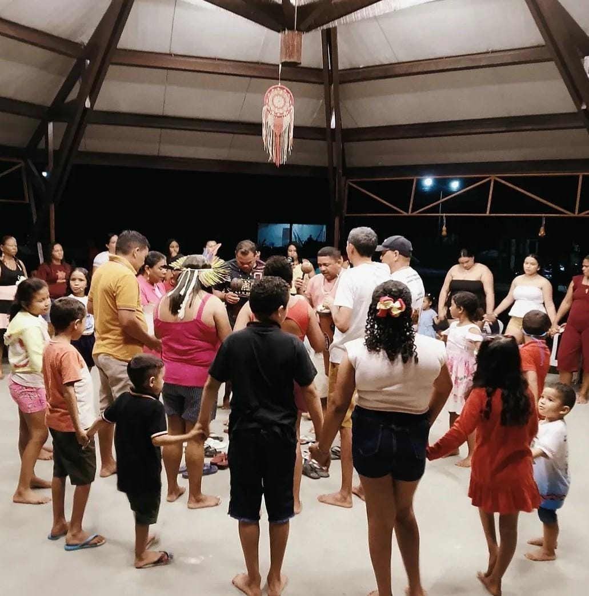

Faltam poucos dias para o segundo turno das eleições presidenciais, marcado para 25 de outubro, e o país chega a esse momento dividido e, muitas vezes, exposto a desinformação e pré-conceitos. Entre acirradas disputas nas redes, correntes de mensagens e discursos inflamados, cresce o risco de esquecer algo essencial: o voto não se encerra na urna. Ele decide o destino de milhões de pessoas e define quais políticas chegarão, ou não, às periferias, ao campo e às florestas e matas.

Contudo, esse destino não pesa da mesma forma sobre todos. Quem mais sente as consequências de cada eleição são justamente os que menos aparecem no debate: pessoas em situação de vulnerabilidade, grupos minorizados, comunidades quilombolas, ribeirinhas, extrativistas e povos indígenas. Para eles, a troca de governo não é uma simples alternância de poder, mas a diferença entre ter ou não ter água, escola, posto de saúde e, sobretudo, a garantia de permanecer em seus territórios.

Política e ecologia caminham juntas. Toda decisão sobre a terra é também uma decisão sobre quem pode viver nela. Não por acaso, para os povos tradicionais, a terra é a mãe de todas as lutas. A conquista do território abre caminho para direitos que antes pareciam distantes. Um direito conquistado pela luta de gerações de quem segue protegendo os rios, a terra e as matas. É essa terra que sustenta a cultura e garante a segurança alimentar e a autonomia desses povos, mas seus benefícios vão muito além das fronteiras do território e alcançam também quem vive longe dele.

Afinal, as matas e florestas não são apenas paisagem. Ela trabalha, silenciosamente, para todos nós ao regular as chuvas, equilibrar o clima e manter vivo o solo do qual depende a própria produção agrícola. Quando a vegetação é degradada, seja pela mudança no uso da terra, seja pelas alterações climáticas, as perdas chegam ao campo e à mesa, e a conta é paga por todos. Proteger os territórios e manejá-los de forma sustentável, portanto, não é um impeditivo ao desenvolvimento, mas a condição para que ele exista. E os territórios tradicionais guardam boa parte das matas, das nascentes e da biodiversidade que ainda resistem no país, além de tantos saberes ancestrais. Essa proteção, no entanto, nunca está garantida. Precisamos sempre lembrar que a conquista de direitos é lenta, mas a perda pode ser rápida. As décadas de luta dos povos, como a dos Tremembé de Queimadas, em Acaraú (CE), podem ser fragilizadas por mudanças constitucionais em debate no Congresso, como a PEC do marco temporal, que, apesar dos questionamentos, permanece em tramitação na Câmara.

É por isso que o voto consciente é, ou deveria ser, o resultado de um processo de reflexão. E uma das perguntas que cada eleitor pode levar à urna é simples... a sua escolha protege ou ameaça os direitos, os biomas e as pessoas mais vulneráveis?

Que cada um de nós assuma a sua parte, enfrentando a desinformação e apoiando a construção de um país mais justo e sustentável. Afinal, o silêncio também é político.

Quer conhecer um pouco mais da luta e apoiar a comunidade Tremembé de Queimadas? Acesse: <https://www.instagram.com/povo_tremembedequeimadas/>

